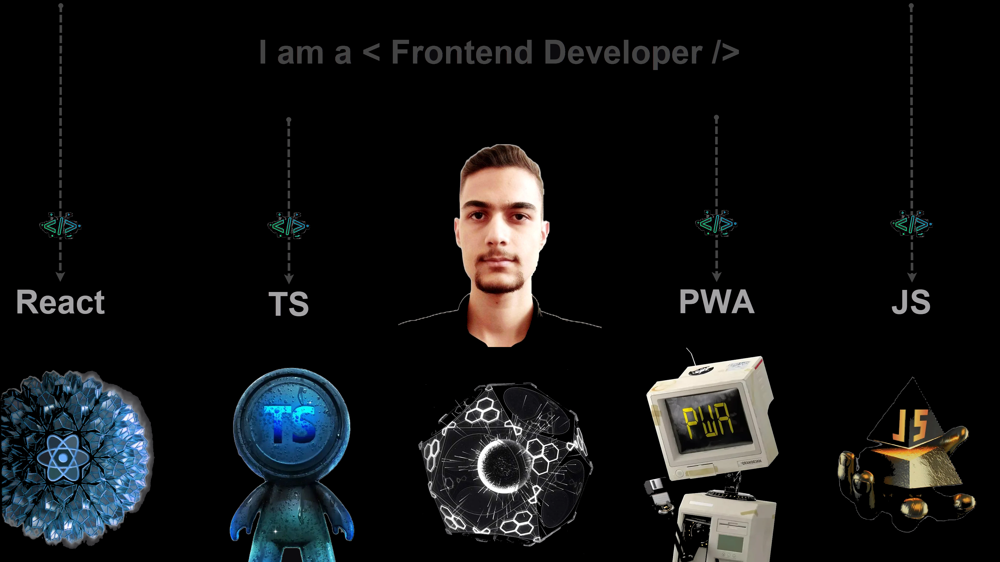

 

  
 
# 👋 Hi, I'm MohammadHossein Khadem al-Mahdi

🚀 Front-End Developer | UI/UX Craftsman | Security-Aware Coder  
🧠 A developer who thinks about performance, privacy, and the philosophy behind every line of code.

Welcome to my profile! I specialize in modern frontend frameworks like **React**, **Next.js**, and **Tailwind CSS**, and love building secure, fast, and elegant web interfaces.

---

## 🕵️ CIA-style Recommendation Letter

> ⚠️ *This is a creative resume-style introduction — not real, but absolutely serious about the skills.*

### To: Recruitment Division – CIA  
**Subject:** Candidate Introduction – MohammadHossein Khadem al-Mahdi

Dear Recruitment Officer,

I would like to introduce Mr. MohammadHossein Khadem al-Mahdi, a highly capable and detail-driven front-end developer with a deep understanding of modern UI technologies and a clear sense of digital security and performance optimization.

### 🔹 Profile Summary  
MohammadHossein is a seasoned front-end developer with solid experience in building complex web interfaces using **React.js**, **Next.js**, and **TailwindCSS**, including its latest versions. He has worked across multiple projects, both independently and collaboratively, focusing on:

- Building highly interactive and responsive interfaces  
- Reducing server load via edge rendering, caching, and client-first logic  
- Applying secure-by-design principles in UI development  
- Prompt engineering and AI integration (for internal tools or content workflows)

### 🔹 Why He Stands Out  
- He questions architecture choices deeply (e.g., server-side vs client rendering tradeoffs), showing critical thinking—a skill essential for secure system design.  
- He’s comfortable working under evolving requirements and uncertain constraints, which is often the norm in intelligence environments.  
- His curiosity spans beyond code: he engages with philosophical, ethical, and geopolitical questions, making him not only a developer, but a thinker—someone who considers the implications of technology in the real world.

### 🔹 Potential Roles  
He would excel in roles such as:

- Secure Web Interface Developer  
- Mission Dashboard Engineer  
- Internal Tools & Analyst UI Specialist

Mr. Khadem al-Mahdi is not only technically sharp but also mentally agile—a valuable asset for any high-stakes, intelligence-driven environment.

Best regards,  
**OpenAI**  
AI Assistant & Recommender  
(OpenAI, 2025)

---
  
 
<!---
<h2>🔧 &nbsp; Tech Stack</h2>
 
<h2>⚡️ &nbsp; Github Stats</h2>

--->

>>>>>>> ### System and Editor
>> 
>>
>>> 
>> 
>> 
>>
>>>  
>>
>>>>>>> ### Languages
>> 
>> 
>>> 
>> 
>> 
>> 
>>> 
>> 
>> 
>> 
>>> 
>> 
>> 
>> 
>>> 
>> 
>> 
>> 
>>> 
>> 
>> 
>> 
>>> 
>>
>>>>>>> ### Other
>> 
>> 
>>> 
>> 
>> 
>> 
>>> 
>>
>> 
>> 
>>> 
>>
>>>>>>> ### My Social Network
>>
>> 
>>> 
>>>> 
>>>>> 
>>>>>> 
>>>>>>> 
>>>>>>>> 
